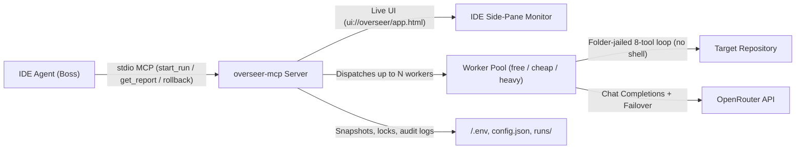

<!-- mcp-name: io.github.Luther22-source/overseer-mcp -->
# Overseer MCP (`overseer-mcp`)

**Keep your IDE agent as the Boss. Offload bounded coding, refactoring, docs, and test-writing to `:free` or low-cost OpenRouter workers.**

Overseer is a local Python `stdio` MCP server (`overseer-mcp`) with a built-in live Monitor UI (`ui://overseer/app.html`). Your primary IDE model stays in control of planning, architecture, and final verification while delegating isolated, folder-jailed file tasks to parallel OpenRouter worker models—with automatic syntax checks, spend caps, secret redaction, and one-click rollback.

---

## Architecture



---

## Quick Start

### 1. Install

Requires **Python 3.11+**. Choose your preferred installer:

```bash
# With pipx (recommended for CLI/MCP tools)
pipx install git+https://github.com/Luther22-source/overseer-mcp

# Or with uv
uv tool install git+https://github.com/Luther22-source/overseer-mcp

# Or from a local clone with pip
git clone https://github.com/Luther22-source/overseer-mcp.git
cd overseer-mcp
pip install -e .
```

*(You can also run it ephemerally with `uvx --from git+https://github.com/Luther22-source/overseer-mcp overseer-mcp`.)*

### 2. Initialize Keys & Verify Setup

Run the interactive setup wizard to store your OpenRouter API key(s) in your OS user data directory (outside any code repository) and verify connectivity:

```bash
overseer-mcp init
overseer-mcp doctor
```

Keys and state live outside your projects:
* **Windows:** `%LOCALAPPDATA%\overseer\.env`
* **macOS / Linux:** `~/.local/share/overseer/.env`

See [.env.example](.env.example) for all supported environment variables.

### 3. Register in Your IDE / MCP Client

Add Overseer to your MCP client configuration (or copy the snippet printed by `overseer-mcp init`):

<details>
<summary><strong>Antigravity</strong> (<code>~/.gemini/config/mcp_config.json</code>)</summary>

```json
{
  "mcpServers": {
    "overseer": {
      "command": "overseer-mcp",
      "args": [],
      "env": {
        "PYTHONUNBUFFERED": "1"
      }
    }
  }
}
```

</details>

<details>
<summary><strong>Claude Desktop</strong> (<code>claude_desktop_config.json</code>)</summary>

```json
{
  "mcpServers": {
    "overseer": {
      "command": "overseer-mcp",
      "args": [],
      "env": {
        "PYTHONUNBUFFERED": "1"
      }
    }
  }
}
```

</details>

<details>
<summary><strong>Cursor</strong> (<code>.cursor/mcp.json</code> or global MCP settings)</summary>

```json
{
  "mcpServers": {
    "overseer": {
      "command": "overseer-mcp",
      "args": [],
      "env": {
        "PYTHONUNBUFFERED": "1"
      }
    }
  }
}
```

</details>

<details>
<summary><strong>Windsurf</strong> (<code>~/.codeium/windsurf/mcp_config.json</code>)</summary>

```json
{
  "mcpServers": {
    "overseer": {
      "command": "overseer-mcp",
      "args": [],
      "env": {
        "PYTHONUNBUFFERED": "1"
      }
    }
  }
}
```

</details>

<details>
<summary><strong>Cline</strong> (<code>cline_mcp_settings.json</code> for VS Code / Cline Desktop)</summary>

```json
{
  "mcpServers": {
    "overseer": {
      "command": "overseer-mcp",
      "args": [],
      "env": {
        "PYTHONUNBUFFERED": "1"
      }
    }
  }
}
```

</details>

*(If you installed into a specific virtualenv rather than globally via `pipx`/`uv tool`, set `"command"` to that virtualenv's `python` and `"args": ["-m", "overseer.server"]`.)*

> **Troubleshooting `spawn uvx ENOENT` (or `spawn overseer-mcp ENOENT`) in GUI clients:** Desktop IDEs often launch without your shell `PATH`. Use the absolute path to `uvx` / `overseer-mcp` (for example from `which uvx` or `where.exe uvx`), or on Windows wrap `uvx` with `"command": "cmd", "args": ["/c", "uvx", "--from", "git+https://github.com/Luther22-source/overseer-mcp", "overseer-mcp"]`.

### 4. Quick Test with MCP Inspector

You can interactively inspect tools, resources (`ui://overseer/app.html`), and prompts using the official MCP Inspector:

```bash
npx @modelcontextprotocol/inspector overseer-mcp
```

*(Or, from a local virtualenv/clone: `npx @modelcontextprotocol/inspector python -m overseer.server`.)*

---

## Tools & Model Tiers

### Boss MCP Tools

| Tool | Purpose |
| :--- | :--- |
| `start_run` | Launch 1–20 tasks (`1–10` concurrent workers via `max_concurrent_workers`) in non-overlapping folders with `shared_contract`, `target_files`, and tier selection |
| `get_report` | Collect status, `diffstat`, `static_check` results, spend, `cached_tokens`, and worker notes |
| `cancel_run` | Gracefully cancel an active run |
| `rollback` | Restore pre-edit file snapshots and delete newly created files (prompts via MCP elicitation when `confirm=False` on supporting clients) |
| `get_config` / `update_config` | Inspect or update model tiers, USD spend caps, concurrency, `key_quotas` preflight, and OpenRouter provider routing (`sort`, `order`, `only`, `allow_fallbacks`, `zdr`, `quantizations`) |
| `list_models` | Search OpenRouter's `/models` catalog (filter by `:free`, tool-calling support, and keyword) |
| `open_overseer_monitor` | Open the interactive MCP App monitor (`ui://overseer/app.html`) in the IDE side pane |

### Model Tiers

| Tier | `model` value | Intended Use | Default Spend Cap |
| :--- | :--- | :--- | :--- |
| **Free** | `null` or `"free"` | Isolated modules, tests, docs, CRUD, well-contracted tasks (`:free` models only) | `$0.00` |
| **Cheap** | `"cheap"` | Multi-block `replace_block` refactoring or trickier debugging | `$0.25` / run |
| **Heavy** | `"heavy"` | Complex architecture or large cross-module tasks using flagship models | `$2.00` / run |

Workers have **no shell access**, are jailed to `project_root` (and their assigned `folder` for writes), respect `.gitignore` and sensitive-file deny globs, redact secrets in outputs, and run static syntax checks automatically on `.py`, `.json`, `.toml`, `.js`/`.jsx`/`.ts`/`.tsx`, `.yaml`/`.yml`, `.luau`, `.ps1`, and `.cpp`/`.h` files before finishing.

---

## Repository Map & Docs

* **MCP Registry Manifest:** [server.json](server.json)
* **Workspace Rules:** [AGENTS.md](AGENTS.md)
* **Boss Playbook Skill:** [.agents/skills/overseer-boss/SKILL.md](.agents/skills/overseer-boss/SKILL.md)
* **Environment Variables:** [.env.example](.env.example)
* **Architecture Spec:** [docs/designs/openrouter-worker-pool-mcp.md](docs/designs/openrouter-worker-pool-mcp.md)
* **Benchmark Harness:** [overseer-bench/BENCHMARK.md](overseer-bench/BENCHMARK.md)

---

## Development & Verification

```bash
pip install -e ".[dev]" ruff
python -m compileall -q overseer tests
ruff check --isolated --select E9,F63,F7,F82,F,I overseer
pytest -v

# UI bundle & tests
npm --prefix overseer/ui ci
npm --prefix overseer/ui run typecheck
npm --prefix overseer/ui test
```

## License

[MIT](LICENSE)
