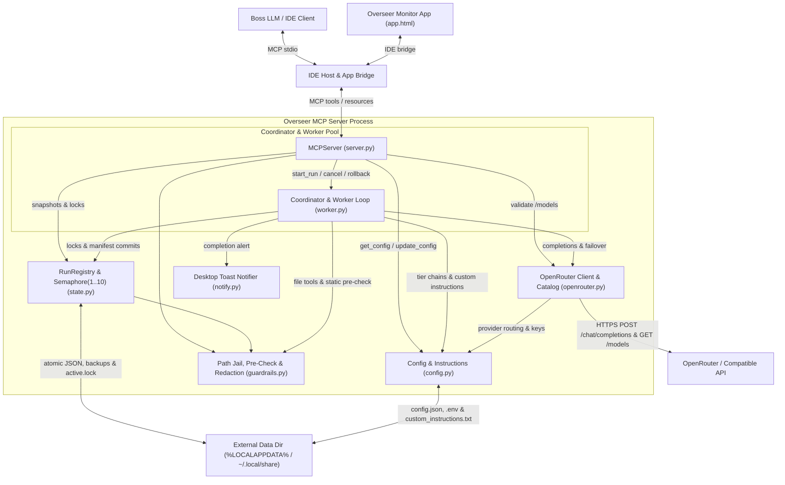

# Overseer MCP Worker Pool Specification

**Status:** Implemented (v4 GitHub-Ready, Hardened & Bucket B Complete — `129 passed, 1 skipped` Pytest, `4/4` UI Tests, Live `doctor` + OpenRouter Smoke-Tested)  
**Author:** Overseer Engineering  
**Last Updated:** 2026-11-27  

---

## Overview

Large orchestrating ("Boss") LLMs incur high latency and token cost when editing many files sequentially, while uncontained sub-agents risk corrupting shared files, leaking API credentials, or polluting target repositories with temporary state. Overseer is a local Python MCP server (`mcp>=2.0,<3.0`) that lets a Boss LLM delegate bounded file-editing tasks across disjoint repository folders to parallel OpenRouter worker agents while preserving strict path containment, externalized run state, and deterministic rollback. It also exposes an interactive MCP App monitor UI (`overseer/ui/dist/app.html`) for live run inspection and cancellation without polling `get_report`.

## Goals

* **Safe parallel delegation:** Run up to 10 concurrent workers per run (`max_concurrent_workers`, default `3`) across disjoint repository subdirectories, enforcing a process-wide worker concurrency cap across projects.
* **Zero repository pollution:** Store all manifests, backups, patches, logs, and API keys outside the target repository under `%LOCALAPPDATA%\overseer` (or `~/.local/share/overseer` on non-Windows, unless `OVERSEER_DATA_DIR` is set).
* **Deterministic recovery:** Record pre-edit SHA-256 backups before every mutation and support idempotent per-run rollback even if worker folders or files were deleted afterward.
* **Cost & loop discipline:** Route `:free` and paid tiers across separate API keys, enforce dollar/step budgets, detect redundant read/repair loops, and prune oversized message histories before upstream context overflow.
* **Interactive observability:** Provide a compact Boss monitor entrypoint and IDE-bridged App UI for live progress, diffs, and cancellation.

## Non-Goals

* **Autonomous Boss test execution:** Overseer delegates file edits and runs offline syntax/ruff pre-checks; executing project test suites or shell commands remains the Boss IDE's responsibility.
* **Cross-worker shared-folder locking:** Workers own disjoint folder prefixes (`validate_non_overlapping_folders`); concurrent edits to the same directory within one run are rejected upfront.
* **Local LLM hosting:** Inference runs against OpenRouter (or an explicit OpenAI-compatible HTTPS endpoint) rather than bundling local model weights; see [Alternative 10](#alternative-10-local-llm-inference-via-ollama).

---

## Critical User Journeys

1. **Parallel Scoped Edit Run:** The Boss inspects the repo, calls `start_run` with a `shared_contract` and disjoint folder tasks (`worker_id`, `folder`, `goal`, optional `target_files`, optional `model`), receives an immediate `StartRunResponse(status="running")` acknowledgment, and waits until the user asks to collect results via `get_report`. Workers edit only inside their assigned folders, run static pre-checks on `finish()`, and write bounded summaries and file diffs.
2. **Escalation & Recovery:** If a worker hits an upstream failure, budget cap, stagnant read loop, or failed static pre-check on its final step, it stops with an explicit `escalation_reason` while preserving partial `created_files`, `modified_files`, and unified diffs for Boss review via `get_report`.
3. **Run Rollback:** When a run leaves unwanted changes, the Boss calls `rollback(project_root, run_id)` to verify backup SHA-256 hashes, restore modified files, remove newly created files and empty newly created directories, and preserve a post-rollback inspection patch.
4. **Cancellation & Teardown:** Calling `cancel_run` (in-process or from another MCP process via `cancel.flag`) cancels queued/active workers, aborts in-flight HTTP retries/requests within `0.25s`, releases `active.lock`, and still allows `rollback`. On server shutdown, `RunRegistry.shutdown_all` drains shielded manifest commits within a bounded deadline and marks unfinished runs `"interrupted"`.
5. **Interactive Monitor App:** Calling `open_overseer_monitor` renders the bundled 3-tab single-file MCP App UI (`Runs`, `Models & Routing`, `Instructions`) in the IDE pane, listing runs across known projects, auto-polling active runs every `2.5s` via 10 IDE-bridged App tools (`app_list_runs`, `app_get_run_snapshot`, `app_cancel_run`, `app_rollback_run`, `app_get_worker_patch`, `app_list_models`, `app_get_custom_instructions`, `app_set_custom_instructions`, `app_get_config`, `app_update_config`), and offering one-click cancellation, rollback, tier/provider configuration, and optional saved custom instructions.

---

## Technical Plan

### 1. System Architecture & Data Flow

| Module | Responsibility | Link |
| :--- | :--- | :--- |
| Server & App Entrypoints | MCP `stdio` server, lifespan shutdown, Boss/App tools, `ToolAnnotations`, rotating redacted logs | [`overseer/server.py`](../../overseer/server.py) |
| CLI Setup & Diagnostics | `overseer-mcp init` and `overseer-mcp doctor` (multi-key `/models` verification) | [`overseer/cli.py`](../../overseer/cli.py) |
| Data Models | Pydantic v2 request, manifest, tool-arg, and monitor snapshot schemas | [`overseer/models.py`](../../overseer/models.py) |
| Guardrails & Pre-Check | Root policy, path jail, symlink/junction checks, secret redaction, syntax/ruff scanners | [`overseer/guardrails.py`](../../overseer/guardrails.py) |
| External State & Locks | Project `active.lock`, LRU manifest cache, bounded reports, rollback, patches | [`overseer/state.py`](../../overseer/state.py) |
| Config & Custom Instructions | `.env`/`config.json` loader, tier chains (`free`/`cheap`/`heavy`), limits, provider routing, custom instructions | [`overseer/config.py`](../../overseer/config.py) |
| OpenRouter Client & Catalog | TTL `/models` catalog, HTTP retry/failover, `provider` routing injection, worker tool schemas | [`overseer/openrouter.py`](../../overseer/openrouter.py) |
| Worker Pool | 8-tool worker loop, context pruning, stagnation/read-loop breakers, coordinator | [`overseer/worker.py`](../../overseer/worker.py) |
| Desktop Notifications | Non-blocking cross-platform toast helper (Windows PowerShell, macOS `osascript`, Linux `notify-send`) | [`overseer/notify.py`](../../overseer/notify.py) |
| Monitor UI | 3-tab `esbuild` + TypeScript + `@modelcontextprotocol/ext-apps` single-file bundle (`< 500 KiB`) | [`overseer/ui/src/app.ts`](../../overseer/ui/src/app.ts) |

---

### 2. Core Data Models, External State & Security Boundaries

* **Request & Manifest Schemas ([`overseer/models.py`](../../overseer/models.py)):**
  * `WorkerTaskInput` enforces lowercase/case-insensitive unique `worker_id` values per run (`task.worker_id.lower()`), non-empty `folder`, `goal` (`<= 20,000` chars), `target_files` (`<= 50` entries, no existing directories), and optional `model` (`"free"`, `"cheap"`, `"heavy"`, or explicit OpenRouter slug).
  * `StartRunRequest` caps `shared_contract` at `<= 50,000` chars and `tasks` (`1..20`). `StartRunRequest.max_run_usd` is optional (`None` by default) and `resolve_effective_max_run_usd()` computes `max(...)` over non-free tiers only, falling back to `DEFAULT_CHEAP_MAX_RUN_USD` (`0.25`) only when all requested models are `free`. `RunLimits` bounds `max_run_usd` (`> 0` and `<= 50.0`, default `0.25` for `free`/`cheap`, `2.00` for `heavy`), `max_steps_per_worker` (`1..200`, default `25`), `max_429_wait_seconds` (`0..300`, default `30`), and `request_timeout_sec` (`> 0` and `<= 600.0`, default `60.0`).
  * `OverseerConfigFile` (`<data_dir>/config.json`) stores `version`, `tiers: dict[TierName, TierConfig]` (`primary`, optional `fallbacks`, `max_run_usd`), `max_concurrent_workers` (`1..10`, optional), `provider_tiers: dict[TierName, ProviderRoutingRule]`, and `provider_models: dict[str, ProviderRoutingRule]` (`sort`, `order`, `only`, `allow_fallbacks`, `zdr`, `quantizations`, with `ConfigDict(extra="forbid")`).
  * `RunManifest` records `version`, `run_id`, `server_pid`, `server_pid_create_time`, `created_at_iso`, `project_root`, `status`, `limits`, `patch_dir`, `spend_usd`, `cached_tokens`, and `workers: dict[str, WorkerManifestState]`.
* **Project Root & Path Jail ([`overseer/guardrails.py`](../../overseer/guardrails.py)):**
  * `_validate_project_root_policy` rejects filesystem roots, `home_dir` and its ancestors, `~/.gemini/`, `<data_dir>`, sensitive home subdirectories (`.ssh`, `.aws`, `.gnupg`, `.kube`, `.docker`, `.config/gcloud`), and OS system directories (`SystemRoot`, `ProgramFiles`, `/etc`, etc.).
  * `validate_raw_path_syntax(raw_path: str)` accepts only a `str` (no `allow_leading_slash` parameter), rejecting empty/whitespace-only strings, leading whitespace, NUL bytes, UNC/device prefixes (`\\`, `//`), drive-less rooted paths (`\foo`, or `/foo` on `win32`), drive-relative paths (`C:foo`), Alternate Data Streams (`:`), `..` traversal segments, reserved Windows device names, and trailing spaces/dots on path components (internal spaces are allowed). On POSIX (`sys.platform != "win32"`), a leading `/` passes syntax validation and `resolve_scoped_path` enforces containment inside `project_root` (accepting valid absolute paths inside `project_root`).
  * `resolve_scoped_path` normalizes against `project_root`, verifies every existing ancestor via `_ensure_no_reparse_escape` (`is_reparse_point`: `is_symlink()` or Windows `is_junction()`), and checks `is_normcase_relative_to`. Shared guardrails helpers also provide `is_pid_alive()` (with 64-bit safe `_win32_kernel32()`), `_normcase_path()` (used in `get_project_data_dir()` and `_prune_empty_dirs()`), and `atomic_write_bytes_sync(..., mode=None)` (using `os.open(..., mode)` + `os.fchmod` before writing on POSIX).
* **Denied Files & Traversal Exclusions:**
  * `DENY_GLOBS` / `_BASENAME_DENY_PATTERNS` block `.env`, `.env.*`, `.envrc`, `*.env`, `*.pem`, `*.key`, `*.p12`, `*.pfx`, `*.crt`, `*.cer`, `*.der`, `*.p8`, `*.jks`, `*.keystore`, `*.ppk`, `*.kdbx`, `*.tfstate*`, `*.tfvars`, `*.tfvars.json`, `kubeconfig`, `*.kubeconfig`, `.htpasswd`, `credentials.json`, `*service-account*.json`, `*service_account*.json`, `*credentials*.{json,yaml,yml,toml,ini}`, `*secret*.{json,yaml,yml,toml,ini}`, `id_rsa*`, `id_ed25519*`, `id_ecdsa*`, `id_dsa*`, `.terraform`, `.terraform/**`, `*.age`, `*.gpg`, `*.asc`, `.vault-token`, `.secrets`, `*.secrets`, `auth.json`, `tokens.json`, `.npmrc`, `.pypirc`, `.netrc`, `_netrc`, `.git-credentials`, `.pgpass`, `.my.cnf`, `.gitmodules`, `.ssh`, `.gnupg`, `.kube`, `.aws`, `.git`, `.githooks`, `.husky`, `.vscode`, `.idea`, `.gemini`, `.claude`, `.cursor`, and `.overseer`.
  * `_PREFIX_DENY_PATHS` covers 15 directory/file prefixes (`.ssh`, `.gnupg`, `.kube`, `.docker/config.json`, `.aws`, `.git`, `.githooks`, `.husky`, `.vscode`, `.idea`, `.gemini`, `.claude`, `.cursor`, `.github/workflows`, `.overseer`) matched by `is_denied_rel_path()` at any nesting depth (`cleaned == prefix`, `cleaned.startswith(prefix + "/")`, or `f"/{prefix}/" in f"/{cleaned}/"`), whereas `_BASENAME_DENY_PATTERNS` omits multi-segment paths (`.docker/config.json` and `.github/workflows`).
  * `IGNORED_DIRS_LOWER` skips noisy build/VCS directories (`node_modules`, `.git`, `.venv`, `__pycache__`, `dist`, `build`, `target`, `vendor`, etc.) case-insensitively during directory walks.
* **Secret Redaction & Static Pre-Check:**
  * `_SECRET_REDACTION_RE` scrubs `Bearer` tokens, `sk-or-`, `sk-`, `ghp_`, `github_pat_`, `AKIA`, `AIza`, `xox[baprs]-`, URL basic-auth (`https?://user:pass@`), and URL query-string secrets (`api_key`, `token`, `secret`, `key`, `password`) via `redact_secrets()`. Redaction applies to `escalation_reason`/`stop_reason`, worker `summary`, `notes`, `static_check.errors`, rotating logs, `logging.StreamHandler(sys.stderr)`, `ToolError` messages, `openrouter_network_error`, `execute_worker_tool` error strings, and `_on_toast_done`.
  * `run_static_precheck` re-validates every touched file via `resolve_scoped_path`, skips files exceeding `MAX_VIEW_FILE_BYTES` (`10 MiB`), wraps results in `redact_secrets()`, validates `.py` (`ast.parse`), `.json`, `.toml`, `.js`/`.jsx`/`.ts`/`.tsx` (`_check_jsts_source`), `.yaml`/`.yml` (`_check_yaml_source`), and runs two-pass comment/string-stripping brace/delimiter scanners for `.luau` (with `--!strict` opt-in via `OVERSEER_LUAU_REQUIRE_STRICT`), `.ps1`, and `.cpp`/`.cc`/`.cxx`/`.h`/`.hpp`. Optional isolated `ruff` checks run with a minimal env unless `OVERSEER_DISABLE_RUFF` (`1`/`true`/`yes`) disables them.
* **External State, Locks & Rollback ([`overseer/state.py`](../../overseer/state.py)):**
  * `<data_dir>/projects/<project_slug>/` stores `active.lock`, `runs/<run_id>/manifest.json`, `runs/<run_id>/<worker_id>.patch`, and `backups/<run_id>/...`.
  * `acquire_project_active_lock_sync` creates `active.lock` atomically, verifies live PID + `pid_create_time` (via `/proc/<pid>/stat` on Linux or `ctypes` `GetProcessTimes` on Windows) + non-terminal manifest status before rejecting, serializes stale lock cleanup under `active.lock.reclaim`, re-checks `stale_sig` (`run_id`, `pid`, `pid_create_time`) before unlinking `active.lock`, and makes up to `5` attempts (`0.08s` backoff on contention when not immediately reclaimed).
  * `_MANIFEST_STAT_CACHE` is a thread-safe (`_MANIFEST_CACHE_LOCK`) `OrderedDict` LRU (capacity `2,048`) keyed by path storing `(st_mtime_ns, st_size, st_ino, RunManifest)` (matching `_DOTENV_CACHE` and `_CONFIG_CACHE` in `config.py`, which also include `st_ino` to avoid stale hits across same-size atomic `os.replace` writes). `_load_manifest_cached_sync` and `_scan_candidate_manifests_sync` accept `copy=False` for read-only `list_all_runs_snapshot()` polling. Cross-project scans (`list_all_runs_snapshot`) apply `per_project_cap=max(effective_limit, 25)` plus `active.lock` priority, and validate `manifest.project_root` via `validate_historical_project_root`, with `_reconcile_manifest_liveness_locked` deriving `manifest_path.parents[2]` internally.
  * `rollback_run` is an async coroutine offloading per-file I/O via `asyncio.to_thread`, verifying backup SHA-256 hashes, checking `is_file()` so file-replaced-by-directory conflicts record in `skipped_conflicts` without crashing, tolerating deleted `worker.folder` directories via `skipped_conflicts` (appending `worker.modified_files`), and cleaning empty `created_dirs` (with a `legacy created_dirs is None` pruning fallback). `collect_run_report` serializes concurrent patch/manifest writes under `RunRegistry.get_report_lock(run_id)`, skipping patch diffs for files exceeding `2 MiB` (`_MAX_PATCH_FILE_BYTES`).

---

### 3. MCP Tools, App Tools & Monitor UI

#### Overseer Boss Tools

| Tool | Purpose & Key Contract |
| :--- | :--- |
| `start_run` | Validates `StartRunRequest`, loads `.env`/`config.json` & `/models` catalog (prompting via MCP elicitation `_MissingApiKeySchema` in-memory if a key is missing on supporting clients), resolves tier spend cap, calls `registry.get_worker_semaphore()` before `registry.register_run()` (allowing `max_concurrent_workers` resizes between runs), acquires `active.lock`, holds the per-run lock across initial manifest write, `latest_run.txt` pointer write, task spawn, and `attach_tasks()`/`attach_coordinator()`, launches up to `max_concurrent_workers` concurrent workers under the global semaphore (default `3`, configurable `1..10` via `OVERSEER_MAX_CONCURRENT_WORKERS`), and returns `StartRunResponse` immediately. |
| `get_report` | Reconciles PID liveness on disk, writes bounded per-worker patches (also written on run completion in `_coordinator()` when `manifest.status != "rolled_back"`), and returns `GetReportResponse` (`run_id`, `project_root`, `status`, `spend_usd`, `cached_tokens`, `patch_dir`, `full_report_path`, `truncated`, `workers` with `cached_tokens`, `escalation_reason`, `static_check`, diffs/notes). |
| `cancel_run` | Marks active in-process runs cancelled (also releasing `active.lock` in its `coord_task is None` fallback) or writes `<project_data_dir>/runs/<run_id>/cancel.flag` for foreign-process runs, stopping queued/active workers without blocking rollback. |
| `rollback` | Resolves `run_id` (`"latest"` or explicit ID) via `validate_and_resolve_run_id()` before prompting, restores pre-edit SHA-256 backups (verifying `backup_path` containment), deletes created files/empty created dirs, marks `status = "rolled_back"`, and returns restored/deleted/skipped lists. When `confirm=False` and the client supports MCP elicitations (`_supports_elicitation`), prompts via `_RollbackConfirmSchema` with the resolved run ID (non-breaking fallback on unsupported clients). |
| `get_config` | Returns effective `tiers` (`free`, `cheap`, `heavy` primary, fallbacks, per-run `max_run_usd`), `max_concurrent_workers`, `env_overrides`, `provider_routing` (`tiers` and `models`), `config_path`, boolean `api_keys_configured` flags (never raw secrets), and `key_quotas` (`fetch_openrouter_key_quotas(client=server_state.client)`, with `"unavailable"` fallback). |
| `update_config` | Serialized under in-process `OverseerServerState.config_lock` and cross-process `data_dir_file_lock("config")` (token-owned + PID-liveness checked), validates changed/added model slugs against OpenRouter `/models` (`tools` capability + `:free` suffix on `free` tier; supports missing-key MCP elicitation fallback), loads existing `<data_dir>/config.json` strictly (`strict=True`), merges partial `tiers` / `max_concurrent_workers` / `provider_routing` updates atomically (capping `provider_models` at `100` entries), and returns the effective config snapshot. |
| `list_models` | Queries OpenRouter `/models` across configured tier keys (`free_only`, `tools_only`, `search`, `limit`; supports missing-key MCP elicitation fallback) and returns compact sorted `ModelSummary` entries. |

* All Boss tools carry MCP `ToolAnnotations` (`readOnlyHint`, `destructiveHint`, `idempotentHint`, `openWorldHint`).
* `MCPServer.instructions` tells clients to `"wait for the user to ask for results before calling get_report"`, and the `start_run` docstring explicitly instructs: **`Do NOT call get_report in a polling loop`**.

#### `open_overseer_monitor`

* Accepts optional `project_root` and `run_id`, validates `project_root` via `validate_historical_project_root`, falls back to `find_run_across_projects_sync(run_id)` when a `run_id` sits outside the global top-20 list, caps `selected_run` at `max_bytes=8192`, and returns `{project_root, runs, active_count, selected_run, summary}` (with `meta.ui.resourceUri` pointing to `ui://overseer/app.html` and a human-readable `summary` for non-UI MCP clients).

#### App-Only Monitor Tools

* `app_list_runs(project_root=None, limit=20, offset=0)` validates optional `project_root` via `validate_historical_project_root`, clamps `limit` to `0..200`, and returns `{"runs": ..., "active_count": ..., "total_count": ..., "has_more": ...}`.
* `app_get_run_snapshot(project_root, run_id)` validates `project_root` via `validate_historical_project_root` and returns a `get_run_monitor_snapshot` payload (`RunSnapshot` in `app.ts`) with `prompt_tokens`, `completion_tokens`, and `cached_tokens` on workers, `cached_tokens` on the run, and per-worker caps (`static_check.errors[:20]`/`300` chars, `summary` `2000` chars, `notes[:20]`/`300` chars, `escalation_reason` `500` chars, `touched_files[:200]`, plus `_safe_file_uri` links).
* `app_cancel_run(project_root, run_id)` validates `project_root` via `validate_historical_project_root` and delegates to `cancel_active_run` / `cancel.flag`.
* `app_rollback_run(project_root, run_id="latest", confirm=True)` validates `project_root` via `validate_historical_project_root` and triggers `rollback_run` from the Monitor UI.
* `app_get_worker_patch(project_root, run_id, worker_id)` calls `read_worker_patch_sync()`, which returns the unified patch diff (capped) for a worker—generating missing `.patch` files on demand while respecting `rolled_back` status—directly inside the Monitor UI.
* `app_list_models(free_only=False, tools_only=True, search=None, limit=50)` mirrors `list_models` for the **Models & Routing** UI tab.
* `app_get_custom_instructions()` and `app_set_custom_instructions(instructions)` load, save, or clear optional user rules in `<data_dir>/custom_instructions.txt` (max `20,000` chars).
* `app_get_config()` and `app_update_config(tiers=None, provider_routing=None, max_concurrent_workers=None)` mirror `get_config` / `update_config` for the **Models & Routing** UI tab.

#### Overseer Monitor Resource & Client UI

* Serves [`overseer/ui/dist/app.html`](../../overseer/ui/dist/app.html) (`ui://overseer/app.html`, overridable via `OVERSEER_APP_HTML` in `os.environ` or `.env`) with explicit `ResourceCSP` metadata (`meta={"ui": {"prefersBorder": False, "csp": {"connectDomains": [], "resourceDomains": []}}}`), built by [`overseer/ui/build.mjs`](../../overseer/ui/build.mjs), which enforces `MAX_BUNDLE_BYTES = 500 * 1024` (`< 500 KiB`) for the self-contained `esbuild` bundle, type-checked with `tsc --noEmit` ([`overseer/ui/tsconfig.json`](../../overseer/ui/tsconfig.json)).
* [`overseer/ui/src/app.ts`](../../overseer/ui/src/app.ts) (backed by [`config_helpers.ts`](../../overseer/ui/src/config_helpers.ts), [`signature.ts`](../../overseer/ui/src/signature.ts), [`types.ts`](../../overseer/ui/src/types.ts), and [`styles.css`](../../overseer/ui/src/styles.css)) renders a persistent 3-tab shell (**`Runs`** | **`Models & Routing`** | **`Instructions`**) with zero `innerHTML` and zero external links. Polling (`2.5s`) updates only the **`Runs`** panel while keeping unsaved edits in **`Models & Routing`** and **`Instructions`** intact. It also supports live `Runs` search filtering, `Copy ID`, `buildConfigUpdatePayload()` diff-only tier patching, `setCustomValidity()` USD cap validation (`> 0` and `<= 50.0`), `pendingPostConnectUpgrade` (upgrading truncated 8 KB initial snapshots after `app.connect()` if `ontoolresult` arrives early), and zero-server standalone browser preview mode (`isStandaloneWindow()`, `?theme=&tab=`, `window.__OVERSEER_LOAD_PREVIEW__` / `window.__OVERSEER_PREVIEW__`).
* `_safe_file_uri` returns `""` only when `project_root` is missing on disk or the path fails `resolve_scoped_path` (deleted files inside an existing `project_root` still emit a `file:///` URI).

---

### 4. Worker Execution Loop, Model Routing & Reliability

#### Model Catalog, Key Routing, Provider Preferences & Retry Policy

* **Configuration precedence:** `os.environ > <data_dir>/config.json > <data_dir>/.env > hardcoded defaults`. Secrets (`OPENROUTER_*_API_KEY`) live strictly in `.env` / `os.environ`.
* **Environment variables:** `OPENROUTER_FREE_API_KEY`, `OPENROUTER_CHEAP_API_KEY`, `OPENROUTER_HEAVY_API_KEY`, `OPENROUTER_API_KEY`, `OPENROUTER_BASE_URL`, `OVERSEER_FREE_DEFAULT_MODEL`, `OVERSEER_DEFAULT_MODEL`, `OVERSEER_FREE_FALLBACK_MODELS`, `OVERSEER_FALLBACK_MODELS`, `OVERSEER_CHEAP_DEFAULT_MODEL`, `OVERSEER_CHEAP_FALLBACK_MODELS`, `OVERSEER_HEAVY_DEFAULT_MODEL`, `OVERSEER_HEAVY_FALLBACK_MODELS`, `OVERSEER_ALLOW_INSECURE_BASE_URL`, `OVERSEER_DATA_DIR`, `OVERSEER_APP_HTML`, `OVERSEER_MAX_CONCURRENT_WORKERS` (`1..10`, default `3`), `OVERSEER_MAX_RUNS_PER_PROJECT` (default `50`; `<= 0` disables pruning), `OVERSEER_DISABLE_TOASTS` (`1`/`true`/`yes`), `OVERSEER_DISABLE_RUFF` (`1`/`true`/`yes`), and `OVERSEER_LUAU_REQUIRE_STRICT` (`1`/`true`/`yes`). All optional runtime flags are resolved via `get_config_value()` (`os.environ` > `<data_dir>/.env`).
* **CLI & Packaging (`overseer/cli.py`, `pyproject.toml`, `server.json`):** Requires Python `>=3.11`. `overseer-mcp --help` / `-h` prints concise CLI usage and exits `0`. `overseer-mcp init` writes `<data_dir>/.env` atomically via `atomic_write_bytes_sync(..., mode=0o600)` (`0600` on POSIX), tests OpenRouter `/models` connectivity, and prints copy-paste MCP snippets (Antigravity, Claude Desktop, Cursor, Windsurf, Cline). `overseer-mcp doctor` verifies Python version (`>=3.11`), key presence via `overseer.config._usable_key`/`get_configured_tier_keys` (without printing secrets), `config.json`, `app.html` (via `get_config_value("OVERSEER_APP_HTML")`), optional `ruff`, configured tier slugs (normalized via `MODEL_SLUG_ALIASES`) across keys on OpenRouter, and live `GET /api/v1/key` credits/`:free` rate limits (skipped under `--offline`). Root `server.json` provides the Official MCP Registry (`pypi`/`uvx`) manifest.
* **Tiers & `heavy` tier:** `free` and `cheap` ship with default OpenRouter slugs; `heavy` starts unconfigured (`primary: null`) until configured in `config.json` or env vars (calling `start_run` with `model="heavy"` while unconfigured raises an error). When `start_run` omits `max_run_usd`, it applies the highest configured tier cap among non-free tiers (`$0.25` default for `free`/`cheap`, `$2.00` default for `heavy`).
* **Key & provider routing:** `:free` models strictly use `OPENROUTER_FREE_API_KEY` -> `OPENROUTER_API_KEY` (never paid keys, and `select_api_key_for_model(..., tier="free")` / `_call_openrouter_with_failover` refuse non-`:free` slugs). `heavy` models use `OPENROUTER_HEAVY_API_KEY` -> `OPENROUTER_CHEAP_API_KEY` -> `OPENROUTER_API_KEY`. Optional OpenRouter `provider` routing (`sort`, `order`, `only`, `allow_fallbacks`, `zdr`, `quantizations`) attaches to `/chat/completions` payloads via `to_openrouter_dict()`, with exact `provider_models[slug]` overrides (max `100` entries) taking precedence over `provider_tiers[tier]`. All OpenRouter requests send `"X-OpenRouter-Title": "Overseer MCP"`.
* **Prompt caching & token accounting:** `_supports_prompt_caching` and `_apply_prompt_cache_control` attach `cache_control: {"type": "ephemeral"}` to the system prompt text part and final tool in `WORKER_TOOL_SCHEMAS` on supported OpenRouter models (`anthropic/`, `qwen/`, `google/gemini-` on `DEFAULT_OPENROUTER_BASE_URL`), with automatic one-shot HTTP 400 fallback without `cache_control` that records `(base_url, model_id)` in bounded `_prompt_cache_unsupported` (max `256`) so subsequent steps skip `cache_control`. `overseer/worker.py` extracts `cached_tokens` from `usage.prompt_tokens_details.cached_tokens` (or top-level `usage.cached_tokens`, degrading to `0`) and surfaces it in `WorkerManifestState`, `RunManifest`, `WorkerReportItem`, and `GetReportResponse`.
* **`GET /api/v1/key` quota preflight:** `fetch_openrouter_key_quotas(timeout=5.0, client=None)` / `fetch_openrouter_key_quotas_sync()` query `GET {base_url}/key` once per distinct configured tier key (`get_configured_tier_keys()`), reuse an optional `httpx.AsyncClient` (`server_state.client` in `get_config`), cache `"ok"` responses for `30s` keyed by `(base_url, sha256(key))` (max `64`, with `clear_key_quota_cache()`), never raise, never expose raw keys, and redact any error text.
* `ModelCatalog` keys cached metadata by `(base_url, sha256(api_key))` (`ttl_sec=3600.0`), retries transient `429, 502, 503, 504` responses in `ensure_loaded()`, and provides `suggest_free_tool_models()` and `list_models()`.
* `_post_with_cancel_flag_poll` races `client.post` against `cancel_event.wait()` via `FIRST_COMPLETED` while polling `cancel.flag` every `0.25s`, immediately aborting pending sibling HTTP requests on budget halt or in-process cancel while returning simultaneously completed responses so billed usage is preserved. `parse_rate_limit_wait_seconds` parses `Retry-After` or `X-RateLimit-Reset` (epoch ms); when `max_429_wait_seconds <= 0`, `429` fails over immediately while non-429 transient retries use a `0.05s` backoff floor.

#### Worker Tools, Context Pruning & Loop Breakers

* **Tools:** `view_file` (`MAX_VIEW_FILE_BYTES` = `10 MiB`), `file_outline` (`.py`, `.js`/`.jsx`/`.ts`/`.tsx`, `.yaml`/`.yml`, `.go`, `.rs`, `.luau`, `.ps1`, `.cpp`/`.h`), `list_dir` (filtering symlink targets via `is_denied_rel_path`), `search_dir` (`utf-8-sig`, `case_insensitive`, `file_glob`), `find_file`, `replace_block`, `write_new_file`, and `finish`.
* `apply_replace_block` and `_build_worker_system_prompt` (emitting `project_root.name` only, never the full absolute path) run in `asyncio.to_thread`; `_seed_target_metadata` streams line counts without loading full files into RAM; failed `write_new_file` target writes remove any empty `new_dirs` they created.
* **Context pruning (`prune_message_history`):** `_message_char_len(messages)` counts `messages[0]` (`system` with `shared_contract`), `messages[1]` (`user` `goal`), and `latest_tool_idx` inside the `120,000`-char `max_history_chars` ceiling (excluding `WORKER_TOOL_SCHEMAS`); `latest_tool_idx` is only excluded from prunable `older_candidates` (`keep_recent_tools=6` default, `KEEP_RECENT_TOOLS = 12` in `run_worker_loop`), and older reads/writes are replaced with `[pruned ...]` stubs.
* **Loop breakers:** `_is_unmodified_created_file_read` returns `False` for all distinct created files/slices while `static_check.status == "failed"` remains unresolved. `consecutive_redundant_read_turns` triggers when all reads in a turn have `prev_count >= 1` (`count >= 2`) for both pre-write and post-write phases (post-write reading of distinct unread files does not count toward the stall limit).

#### System Prompt & Optional Custom Instructions

* No hidden or hardcoded domain rules are injected by default.
* Optional user-authored instructions saved via the Monitor UI (`app_set_custom_instructions`, stored in `<data_dir>/custom_instructions.txt`, max `20,000` chars) and optional repo-local `<project_root>/.overseer/instructions.md` (capped at `10 KB`) are appended in `_build_worker_system_prompt`.

#### Run Finalization, Durability & Notifications

* `_commit_manifest_ctx` shields every worker `manifest.json` write inside `registry.track_commit` under `run_lock`.
* `RunRegistry.shutdown_all(timeout_sec=5.0)` shares one `5.0s` monotonic deadline across worker cancellation, shielded commit drains, and coordinator waits (`<= 7.5s` total with `drain_toast_tasks`'s `2.0s` wait + `0.5s` cancel gather, staying `<= 10s` before `client.aclose()`). Best-effort `"interrupted"` status and `active.lock` cleanup run when all worker/commit tasks for that run are `.done()`.
* `send_completion_toast` (with `send_windows_toast` backward-compatible alias) fires on any non-interrupted terminal run when `OVERSEER_DISABLE_TOASTS` is not truthy (`1`/`true`/`yes`) and `PYTEST_CURRENT_TEST` is unset, dispatching Windows PowerShell (resolved via `%SystemRoot%` with minimal env), macOS `osascript`, or Linux `notify-send`.
* `_SafeRotatingFileHandler` applies a `60.0s` cooldown after any log-rollover `OSError`.

---

## Alternatives Considered

1. **Direct Boss Editing vs. Scoped Sub-Agent Pool:** Keeps strong-model reasoning for architecture while offloading bounded folder edits to cheap/free workers.
2. **Git Worktrees vs. Disjoint Folder Locks + External Backups:** Avoids requiring `.git` in target workspaces and leaves zero `.git` / worktree artifacts behind.
3. **Full-File Rewrites vs. Search/Replace Blocks (`replace_block`):** Minimizes token cost and accidental truncation on large files while normalizing majority EOL/BOM.
4. **In-Repo `.overseer/` vs. External AppData State:** Prevents accidental commits of API keys, manifests, or large backup snapshots.
5. **Single `OPENROUTER_API_KEY` vs. Tier-Isolated Dual Keys:** Prevents `:free` runs from silently draining paid `OPENROUTER_CHEAP_API_KEY` credits.
6. **External Subprocess `pytest` Runner vs. Offline Syntax/Ruff Pre-Check:** Keeps worker sandboxes zero-exec so untrusted/weak models cannot run arbitrary shell commands.
7. **Polling `get_report` vs. Non-Blocking `start_run` + MCP App UI:** Eliminates redundant Boss tool-call tokens while still giving humans live visibility.
8. **External CDN Assets vs. Single-File Bundled `app.html`:** Works offline inside IDE webviews without CSP/CDN network dependencies.
9. **Whole-Run File Locks vs. Atomic `active.lock` + `manifest.json`:** Allows lockless historical reads and cross-process cancellation via `cancel.flag`.
10. **OpenRouter Hosted Inference vs. Local LLM Inference via Ollama:** Avoids requiring local GPU VRAM or bundled model weights; local OpenAI-compatible proxies remain usable via `OPENROUTER_BASE_URL` + `OVERSEER_ALLOW_INSECURE_BASE_URL`.
11. **Unbounded Message History vs. Tiered `120,000`-Char Pruning:** Preserves system contract, user goal, and latest tool output while replacing stale reads/writes with `[pruned ...]` stubs.
12. **Process-Only Cancellation vs. `cancel.flag` Cross-Process Polling:** Lets a second MCP process or App UI cancel an active run within `0.25s`.
13. **Global Unbounded Workers vs. Process-Wide `Semaphore(1..10)` (default `3`):** Caps upstream rate-limit pressure across concurrent projects.
14. **Pre-Hardening Ad-Hoc Logs vs. Redacted Rotating Logs + Bounded Snapshots:** Prevents token leaks and context-window floods in Boss/UI payloads.
15. **SSE Streaming Completions vs. Non-Streaming POST:** Non-streaming `POST /chat/completions` simplifies exact usage/cost accounting, `choices` validation, and `0.25s` `cancel.flag` polling without partial-JSON tool-call assembly; streaming can be added later inside `_post_with_cancel_flag_poll` without changing worker schemas.

---

## Risks & Limits

* **In-flight HTTP cancellation & spend:** Cancelling via `cancel.flag` aborts the HTTP wait within `0.25s`, but an already-dispatched OpenRouter request may still incur unrecorded upstream spend. *Mitigation:* Set strict per-key OpenRouter spending caps and conservative `RunLimits.max_run_usd`.
* **Foreign-process `cancel_run` async lag:** `cancel_run` from a second MCP process writes `cancel.flag` and returns before the owning worker finishes unwinding. *Mitigation:* Poll `app_get_run_snapshot` in the UI (or inspect `get_report` after a brief pause) to confirm terminal status before `rollback`.
* **Cross-project scan scaling & orphaned locks:** `list_all_runs_snapshot` is `O(P * min(runs, cap))` across `P` projects and skips historical runs beyond `per_project_cap` when `active.lock` is absent. *Mitigation:* Pass `project_root` or explicit `run_id` to `open_overseer_monitor` (`find_run_across_projects_sync` fallback).
* **Global `Semaphore(1..10)` starvation & overshoot:** Heavy activity in one project can queue workers in another project; when one worker hits `max_run_usd`, `cancel_event.set()` immediately aborts pending sibling HTTP waits, though already-dispatched requests may still incur unrecorded upstream spend prior to socket teardown. *Mitigation:* Set a conservative `max_run_usd` or dispatch fewer tasks per batch on tight dollar budgets.
* **Majority EOL normalization:** `apply_replace_block` normalizes replacements to the file's majority line ending, which can rewrite stray mixed endings in touched files. *Mitigation:* Review unified diffs in `get_report` or `rollback` if exact mixed-EOL preservation is required.
* **`OVERSEER_ALLOW_INSECURE_BASE_URL` plaintext transit:** Enabling plaintext HTTP exposes prompts, code snippets, and bearer headers on the wire. *Mitigation:* Restrict use to `localhost`/`127.0.0.1` proxies and never enable over untrusted networks.
* **`completed_with_escalations` with zero completed workers:** If all workers fail or hit budgets, the run reaches `completed_with_escalations` with `0` completed workers and partial/empty edits. *Mitigation:* Inspect `escalation_reason` in `get_report` and run `rollback` before retrying.
* **Boss-side code review & test execution:** Static pre-checks verify syntax and optional `ruff` lint rules, not runtime behavior. *Mitigation:* The Boss must run project tests after `get_report`.
* **External backup & manifest retention cap:** `prune_old_runs_sync()` runs automatically after each run under `_coordinator()`, deleting oldest non-running `runs/<run_id>/` and `backups/<run_id>/` directories beyond `OVERSEER_MAX_RUNS_PER_PROJECT` (default `50`; `<= 0` disables pruning). *Mitigation:* Set `OVERSEER_MAX_RUNS_PER_PROJECT` higher or `0` if longer rollback retention is required.
* **Unbudgeted `open_overseer_monitor` `runs` list:** `selected_run` is capped at `max_bytes=8192`, while `runs` (up to 20 `RunSummary` entries) is returned directly without a combined byte ceiling (`custom_instructions` and `config` are fetched separately by the UI via app-only tools). *Mitigation:* Invoke `open_overseer_monitor` only when the user requests the Monitor UI.
* **Cross-process config & instruction lock timeout:** `<data_dir>/config.json` and `<data_dir>/custom_instructions.txt` serialize concurrent writes across IDE windows via `data_dir_file_lock` (`O_EXCL` lock file with `5s` wait and `10s` stale-lock reclaim) and `atomic_write_bytes_sync`. *Mitigation:* Avoid scripted rapid-fire `update_config` calls across multiple processes simultaneously.

---

## Verification Status & Plan

### Implemented Repository Files

* [`overseer/__init__.py`](../../overseer/__init__.py), [`overseer/cli.py`](../../overseer/cli.py), [`overseer/config.py`](../../overseer/config.py), [`overseer/models.py`](../../overseer/models.py), [`overseer/guardrails.py`](../../overseer/guardrails.py), [`overseer/state.py`](../../overseer/state.py), [`overseer/openrouter.py`](../../overseer/openrouter.py), [`overseer/worker.py`](../../overseer/worker.py), [`overseer/notify.py`](../../overseer/notify.py), [`overseer/server.py`](../../overseer/server.py), [`server.json`](../../server.json)
* [`overseer/ui/package.json`](../../overseer/ui/package.json), [`overseer/ui/tsconfig.json`](../../overseer/ui/tsconfig.json), [`overseer/ui/build.mjs`](../../overseer/ui/build.mjs), [`overseer/ui/src/app.ts`](../../overseer/ui/src/app.ts), [`overseer/ui/src/types.ts`](../../overseer/ui/src/types.ts), [`overseer/ui/src/config_helpers.ts`](../../overseer/ui/src/config_helpers.ts), [`overseer/ui/src/signature.ts`](../../overseer/ui/src/signature.ts), [`overseer/ui/src/signature.test.ts`](../../overseer/ui/src/signature.test.ts), [`overseer/ui/src/styles.css`](../../overseer/ui/src/styles.css), [`overseer/ui/dist/app.html`](../../overseer/ui/dist/app.html)
* [`tests/test_guardrails_and_state.py`](../../tests/test_guardrails_and_state.py), [`tests/test_mcp_server.py`](../../tests/test_mcp_server.py), [`tests/test_worker_and_openrouter.py`](../../tests/test_worker_and_openrouter.py), [`tests/test_new_features.py`](../../tests/test_new_features.py)

### Offline Verification & Test Harness

* **Harness:** `isolated_env` and `worker_env` redirect `OVERSEER_DATA_DIR` into temp directories, suppress Windows toasts, and mock OpenRouter HTTP via `httpx.MockTransport` plus subprocess mocks (`powershell.exe`, `node`, `ruff`). A live subprocess `stdio` test (`test_round3_stdio_subprocess_framing_refcounted_stdout_and_compact_monitor`) verifies real MCP `stdio` JSON-RPC framing without `stdout` corruption.
* **Latest verified checks (`2026-11-27`):**
  * `npm --prefix overseer/ui run typecheck` (`tsc --noEmit`) — exit `0`
  * `npm --prefix overseer/ui test` (`node --test src/signature.test.ts`) — `4 passed` (`0` failed)
  * `node overseer/ui/build.mjs` — built `overseer/ui/dist/app.html` (`448,129` bytes / `437.6 KB`, zero `innerHTML`, zero external `<script src=` / `<link ` tags)
  * `python -m compileall -q overseer tests` — exit `0`
  * `ruff check --isolated --select E9,F63,F7,F82,F,I overseer` — `All checks passed!`
  * `pytest -v` — `129 passed, 1 skipped` (Windows symlink privilege skip)

### Pre-Hardening Baseline, Live E2E Criteria & Open Questions

* **Benchmark harness:** [`overseer-bench/BENCHMARK.md`](../../overseer-bench/BENCHMARK.md) defines the 10-task batch comparison protocol (`run_normal` solo loop vs. `run_overseer` `:free` batch); no post-hardening live benchmark tally has been recorded yet.
* **Live E2E graduation criteria:** A pre-hardening live OpenRouter + IDE Webview E2E passed on `2026-11-24` (`run_20261124_091403_635e41`); before final production sign-off, run one post-hardening live IDE-hosted MCP session against OpenRouter validating: (1) `start_run` multi-worker edit + `get_report` diff accuracy, (2) `open_overseer_monitor` rendering & live `2.5s` polling in the IDE pane, (3) `cancel_run` + `rollback` restoration, and (4) clean process exit without leaked `active.lock`.
* **Open questions:** Whether future releases should add optional SSE streaming inside `_post_with_cancel_flag_poll` or per-project concurrency quotas beyond the global `Semaphore(1..10)`.
